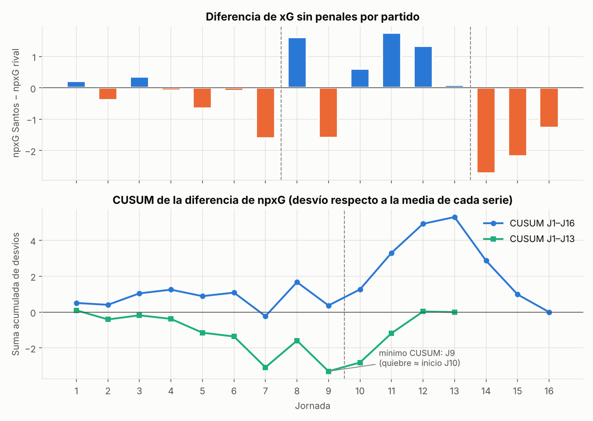
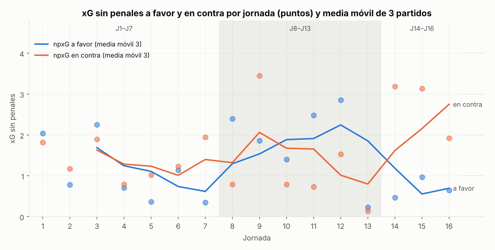
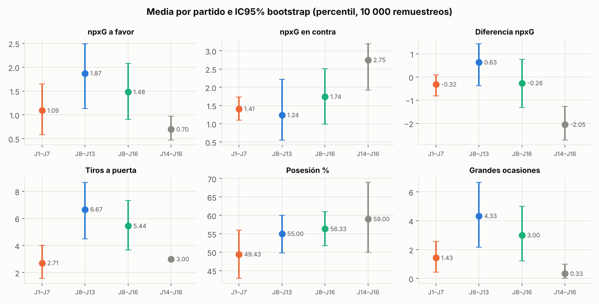
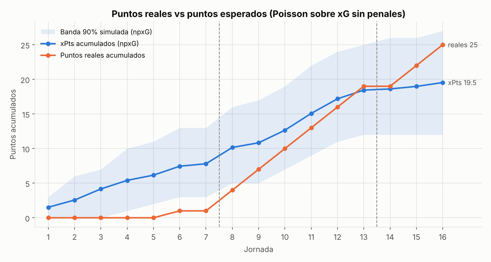
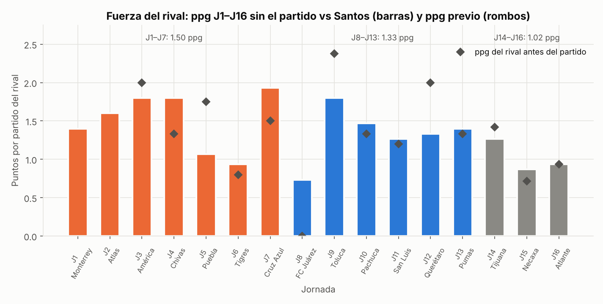
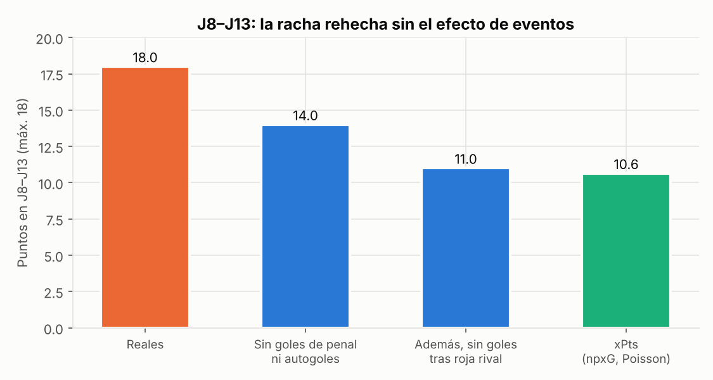
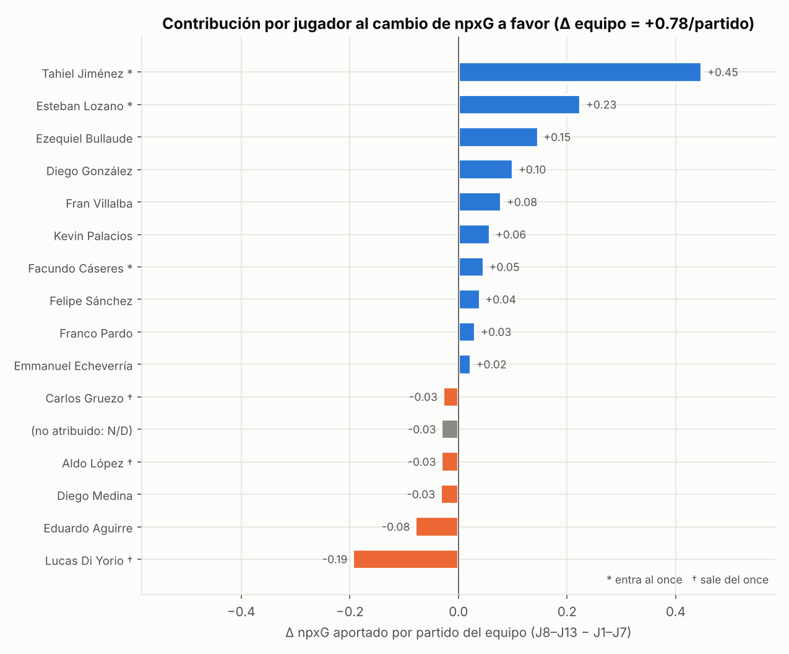
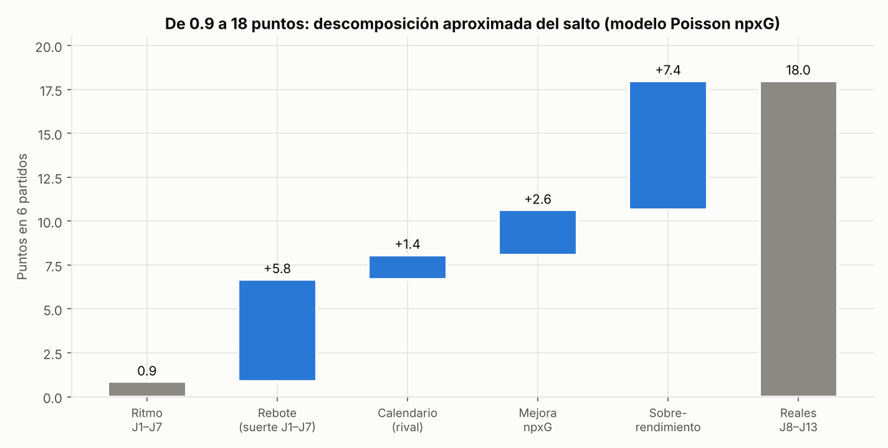

# Santos Laguna, Apertura 2026: ¿mejora real o suerte?

**Pregunta:** ¿qué explica el paso de 1 punto en J1–J7 a 6 victorias seguidas en J8–J13, y cuánto fue mejora real y cuánto suerte, rival o eventos?

Datos: FotMob (xG de Opta), corte 2026-11-19, J1–J16. Medida principal: **xG sin penales (npxG)**. Todas las cifras salen de `src/analisis_santos.py` (semilla 20261120) y están en `tablas.xlsx` (la hoja entre corchetes indica de dónde sale cada tabla).

---

## Resumen ejecutivo

1. **Hubo una mejora real, pero moderada y casi solo ofensiva.** Santos pasó de 1.09 a 1.87 npxG a favor por partido (+0.78; IC95 bootstrap −0.13 a +1.58) y de 2.7 a 6.7 tiros a puerta. El npxG en contra apenas cambió (1.41 → 1.24). Ajustada por rival, la diferencia de npxG pasa de −0.18 a +0.60 por partido.
2. **El salto de puntos es mucho mayor de lo que justifica el xG.** En J1–J7, Santos sumó 1 punto con 7.8 xPts (mala suerte). En J8–J13 sumó 18 con 10.6 xPts (buena suerte; solo 0.6 % de las simulaciones llegan a 18).
3. **Descomposición aproximada del salto (de 0.9 a 18 puntos en 6 partidos):** rebote de la mala suerte de J1–J7, ~34 %; rivales más débiles, ~8 %; mejora de npxG, ~15 % (entre 15 % y 22 % según el escenario); sobre-rendimiento frente a xPts, ~43 %. Este último sale sobre todo de recibir 3 goles sin penal con 7.4 npxG en contra.
4. **Los eventos inflaron la racha.** Cuatro de los 15 goles fueron de penal y hubo rivales expulsados en J9, J12 y J13. Sin goles de penal ni autogoles, la racha queda en 14 puntos; si además se quitan los goles marcados tras la roja rival, en 11.
5. **J14–J16 contradicen la hipótesis de un cambio a "equipo dominante".** Santos generó 2.09 npxG y concedió 8.25 en tres partidos: 6 puntos con 1.1 xPts. Los datos son consistentes con una mejora ofensiva parcial (asociada en buena parte a la entrada de Tahiel Jiménez y Esteban Lozano), amplificada por la regresión a la media, el calendario, los eventos y, sobre todo, la varianza en la definición rival y en las paradas.

---

## 0. Validación de datos

Archivos: 6 CSV + README (el zip y los archivos sueltos son idénticos byte a byte). Están copiados en `santos_analisis/data/`.

| Comprobación [0_verificaciones] | Resultado |
|---|---|
| Fechas válidas; claves únicas (partidos, jugadores, eventos, liga, contexto) | OK, 0 duplicados |
| J1–J16 completas en `partidos_santos`; 144 partidos de liga (9 por jornada, 18 equipos × 16) | OK |
| Resultado y puntos coherentes con el marcador | OK |
| xG − npxG = 0.79 × penales | OK (desviación máx. 0.01) |
| Goles de eventos = marcador; penales de eventos = columnas | OK |
| 11 titulares por partido; goles individuales + autogoles = goles de Santos | OK |
| Partidos de Santos en `resultados_liga` = `partidos_santos` (goles y xG) | OK |
| **PPDA** | **16/16 N/D: queda fuera del análisis** |

**Vacíos (N/D, nunca tratados como cero) [0_ND_por_campo]:** `ppda_santos` 16/16; `asistente` 25/53; jugadores: `tiros` 132/253, `xg` 130/253, `xa` 78/253, `calificacion_fotmob` 25/253. Otros vacíos que señala el README: no hay xGOT, xG por minuto ni xG sin penales en `resultados_liga` (solo xG total), y `linea_base` trae el xG a un decimal y con penales.

**Datos ancla [0_anclas]: todos coinciden.**

| Ancla | Calculado |
|---|---|
| Puntos J1–J7 | 1 (6 P, 1 E) |
| Puntos J8–J13 | 18 (6 G) |
| GF/GC J1–J7 | 4 / 12 |
| GF/GC J8–J13 | 15 / 4 |

---

## 1. Punto de quiebre

**Cortes únicos sobre la diferencia de npxG, J1–J13 [1_cortes_unicos]** (selección):

| Bloque "después" empieza en | Media antes | Media después | Salto | Reducción del error cuadrático |
|---|---:|---:|---:|---:|
| J7 | −0.11 | +0.31 | +0.42 | 4 % |
| **J8** | −0.32 | +0.63 | +0.95 | 22 % |
| J9 | −0.08 | +0.44 | +0.52 | 6 % |
| **J10 (óptimo)** | −0.25 | +0.95 | +1.19 | 29 % |
| J11 | −0.16 | +1.06 | +1.22 | 25 % |

**Detección automática [1_pelt_binseg]:**

| Serie | Método | Quiebre |
|---|---|---|
| Diferencia de npxG, J1–J13 | CUSUM (mínimo) | después de J9, es decir, en J10 |
| Diferencia de npxG, J1–J13 | PELT l2 (penalización BIC / AIC) | J10 |
| Diferencia de npxG, J1–J13 | PELT l2 (2·BIC) | ninguno |
| Diferencia de npxG, J1–J16 | PELT l2 (BIC) | J10 y J14 |
| Diferencia de npxG, J1–J16 | Binseg, 1 quiebre | J14 (la caída) |
| **npxG a favor, J1–J13** | Binseg, 1 quiebre | **J8** |
| npxG en contra, J1–J13 | Binseg, 1 quiebre | J10 |

**Cortes alternativos con IC bootstrap [1_cortes_alternativos]:** J1–J6 vs J7–J13: +0.42 (IC −0.64 a 1.37). **J1–J7 vs J8–J13: +0.95 (IC −0.13 a 1.90).** J1–J8 vs J9–J13: +0.52 (IC −0.72 a 1.64).

**Lectura:**
- El quiebre en **resultados** es exactamente J8. En **xG** es más difuso. El npxG a favor cambia en J8. La diferencia de npxG cambia en J10, porque en J9 (Toluca) Santos ganó 3–2 perdiendo la batalla de xG por −1.59.
- El rango del CUSUM no se distingue del que produce un orden aleatorio de los mismos 13 partidos (permutación p ≈ 0.57, solo descriptiva). Con penalización más estricta, PELT no encuentra quiebre. **Conclusión prudente:** hay un cambio de nivel consistente con un inicio entre J8 y J10, no un quiebre nítido. En J1–J16, la señal más fuerte es la **caída** de J14.

---

## 2. Antes vs después

**Media por partido (IC95 bootstrap percentil, 10 000 remuestreos) [2_bloques_medias_IC]:**

| Métrica | J1–J7 (n=7) | J8–J13 (n=6) | J8–J16 (n=9) |
|---|---|---|---|
| npxG a favor | 1.09 (0.59–1.65) | 1.87 (1.14–2.49) | 1.48 (0.91–2.08) |
| npxG en contra | 1.41 (1.10–1.74) | 1.24 (0.55–2.22) | 1.74 (0.99–2.51) |
| Diferencia npxG | −0.32 (−0.82–0.08) | +0.63 (−0.38–1.43) | −0.26 (−1.31–0.76) |
| xG a favor (con penales) | 1.09 | 2.66 | 2.01 |
| Tiros | 11.6 (8.3–15.1) | 17.2 (13.0–21.2) | 14.8 (11.2–18.4) |
| Tiros a puerta | 2.7 (1.6–4.0) | 6.7 (4.5–8.7) | 5.4 (3.7–7.3) |
| Tiros a puerta del rival | 6.6 (4.4–9.1) | 3.3 (1.2–5.8) | 4.6 (2.6–6.7) |
| Grandes ocasiones | 1.4 (0.4–2.6) | 4.3 (2.2–6.7) | 3.0 (1.2–5.0) |
| npxG por tiro | 0.096 | 0.116 | 0.106 |
| Posesión % | 49.4 (42.9–56.0) | 55.0 (49.8–60.0) | 56.3 (51.8–61.0) |
| PPDA | N/D | N/D | N/D |

**Diferencias J8–J13 − J1–J7 con IC95 bootstrap [2_diferencias_IC]:**

| Métrica | Diferencia | IC95 |
|---|---:|---|
| npxG a favor | +0.78 | −0.13 a +1.58 |
| npxG en contra | −0.17 | −0.97 a +0.82 |
| Diferencia npxG | +0.95 | −0.12 a +1.89 |
| Tiros a puerta | +3.95 | +1.38 a +6.29 |
| Grandes ocasiones | +2.90 | +0.55 a +5.52 |
| Posesión | +5.6 | −2.9 a +13.8 |

> **Límites:** con 6–7 partidos por bloque, los IC son anchos y el bootstrap subestima la incertidumbre en muestras tan pequeñas. Los valores p de permutación de la hoja son descriptivos y no se corrigieron por comparaciones múltiples. No deben leerse como pruebas de significancia.

**Lectura:** el volumen ofensivo subió de forma clara (tiros a puerta y grandes ocasiones, con IC que excluyen el 0). La calidad media por tiro casi no cambió (0.096 → 0.116), así que Santos generó **más** ocasiones, no **mejores** ocasiones. En defensa, los tiros a puerta del rival bajaron, pero el npxG en contra apenas se movió. Si se extiende a J8–J16, la mejora en diferencia de npxG desaparece (+0.06).

---

## 3. Suerte vs calidad (xPts)

Cada partido se simuló 200 000 veces con goles Poisson(npxG a favor) vs Poisson(npxG en contra). El resultado coincide con el cálculo analítico.

**Por bloque [3_xpts_por_bloque]:**

| Bloque | Puntos | xPts (npxG) | Banda 90 % simulada | P(sim ≥ reales) | GF sin pen. − npxG | GC sin pen. − npxG contra |
|---|---:|---:|---|---:|---:|---:|
| J1–J7 | 1 | 7.8 | 3–13 | P(sim ≤ 1) = 1.5 % | −4.6 (3 goles con 7.6) | +1.1 (11 con 9.9) |
| J8–J13 | 18 | 10.6 | 6–15 | 0.6 % | −0.2 (11 con 11.2) | **−4.4 (3 con 7.4)** |
| J14–J16 | 6 | 1.1 | 0–4 | 1.5 % | +0.9 | −4.3 |
| J8–J16 | 24 | 11.7 | 7–17 | <0.1 % | +0.7 | −8.7 |

**Lectura:**
- J1–J7 fue **muy desafortunado**: unos 6.8 puntos por debajo de lo esperado. Santos definió muy por debajo de su npxG (3 goles sin penal con 7.6) y recibió algo más de lo esperado.
- En J8–J13, el ataque definió **en línea** con su npxG (11 goles con 11.2). La "suerte" estuvo en defensa: 3 goles sin penal recibidos con 7.4 npxG en contra. Sin xGOT no se puede separar el mérito de Acevedo de la mala definición rival. Ver sección 6: la diferencia xG − goles con Acevedo pasa de −1.3 en J1–J7 a +4.2 en J8–J13, siendo el mismo portero.

---

## 4. Regresión a la media

¿Cuántos puntos habría esperado en J8–J13 un Santos con el nivel que mostró en J1–J7? [4_escenarios_regresion]

| Escenario | Puntos esperados J8–J13 |
|---|---:|
| A. Ritmo real J1–J7 (1/7 × 6) | 0.9 |
| B. xPts de J1–J7 × 6/7 (mismos rivales fuertes) | 6.7 |
| C. npxG medio de J1–J7 (1.09–1.41) contra los rivales de J8–J13, sin ajuste | 6.8 |
| **D. Fuerza de J1–J7 ajustada por rival, aplicada a los rivales de J8–J13** | **8.1** |
| E. Igual que D, con regresión hacia la línea base histórica (pesos de confiabilidad a 7 partidos: 0.42 a favor, 0.13 en contra) | 7.0 |
| F. Línea base histórica pura (0.94 ppg, Clausura 26 + Apertura 25) | 5.6 |
| I. Regresión en la liga: ppg J8–J13 ~ ppg J1–J7 (17 equipos, r = 0.31) | 5.4 |
| J. Regresión en la liga: ppg J8–J13 ~ xGD J1–J7 (r = 0.23) | 7.0 |
| G. xPts con el npxG real de J8–J13 | 10.6 |
| H. Puntos reales | 18 |

**Confiabilidad del xG en la Liga MX [4_confiabilidad_xg_liga]:** con 7 partidos, solo ~42 % de la variación entre equipos en xG a favor es "señal". En xG en contra es ~13 %, así que 7 partidos dicen muy poco de la calidad defensiva real.

**Lectura:** según el método, un Santos "como el de J1–J7" habría esperado **entre 5.4 y 8.1 puntos** en J8–J13 (escenario central D: 8.1; con regresión a la media: 7.0). **El rebote por sí solo, de 0.9 a ~5–8 puntos, explica entre ~26 % y ~42 % del salto de 17 puntos (34 % en el escenario B que usa la descomposición final).** El resto (≈10 puntos) necesita mejora real, calendario o suerte.

---

## 5. Rival y eventos

**Fuerza del rival [5_fuerza_rival_bloque]** (excluye siempre el partido contra Santos):

| Bloque | ppg del rival antes del partido | xGD/PJ del rival antes | ppg del rival en J1–J16 | xGD/PJ del rival en J1–J16 | % de partidos como local |
|---|---:|---:|---:|---:|---:|
| J1–J7 | 1.73 (J1 sin datos previos) | +0.41 | 1.50 | +0.09 | 43 % |
| J8–J13 | 1.37 | −0.22 | 1.33 | −0.17 | 67 % |
| J14–J16 | 1.02 | +0.21 | 1.02 | +0.12 | 33 % |

Los rivales de J8–J13 fueron algo más débiles, y Santos jugó 4 de 6 en casa (el modelo no ajusta por localía; ver limitaciones). Ajustando el npxG por la calidad ofensiva y defensiva del rival [4_npxg_ajustado_rival], la diferencia de npxG pasa de **−0.18 (J1–J7) a +0.60 (J8–J13)**: +0.78 frente a +0.95 sin ajustar. Es decir, **≈18 % de la mejora de xG se asocia al calendario.**

**Eventos [5_eventos_por_partido]:**

| J | Rival | Marcador | Expulsión rival (min) | Penales a favor / en contra | Autogol a favor | Sin penales ni autogoles | Además, sin goles tras la roja | xPts |
|---|---|---|---|---|---|---|---|---:|
| 8 | Juárez | 2–1 | – | 1 (fallado) / 1 | – | 2–0 | 2–0 | 2.36 |
| 9 | Toluca | 3–2 | 45+7 | – | – | 3–2 | **1–2** | 0.67 |
| 10 | Pachuca | 1–0 | – | 1 / 0 | – | **0–0** | 0–0 | 1.82 |
| 11 | San Luis | 2–1 | – | – | – | 2–1 | 2–1 | 2.42 |
| 12 | Querétaro | 5–0 | 67 | 2 (1 fallado) / 0 | – | 4–0 | 3–0 | 2.11 |
| 13 | Pumas | 2–0 | 2 | 2 / 0 | – | **0–0** | 0–0 | 1.25 |
| 15 | Necaxa | 1–0 | – | – | 1 | **0–0** | 0–0 | 0.36 |
| 16 | Atlante | 2–0 | 15; 90+5 | – | – | 2–0 | **0–0** | 0.56 |

| Bloque [5_eventos_por_bloque] | Reales | Sin penales ni autogoles | Además, sin goles tras la roja rival | xPts npxG |
|---|---:|---:|---:|---:|
| J1–J7 | 1 | 2 | 2 | 7.8 |
| J8–J13 | 18 | 14 | 11 | 10.6 |
| J14–J16 | 6 | 4 | 2 | 1.1 |

**Lectura:** solo 1 de los 6 triunfos de J8–J13 (San Luis) ocurrió sin penal, expulsión rival ni autogol. En Pumas, Santos jugó 88 minutos con un hombre más y generó solo 0.23 npxG; ganó con dos penales. En Toluca, la remontada (goles al 86 y al 90+5) llegó con el rival en inferioridad. El escenario "sin goles tras la roja" es un límite inferior conservador: supone que la expulsión explica todo lo que vino después, y eso no es demostrable.

---

## 6. Quién cambió

El npxG individual se calculó restando 0.79 por cada penal ejecutado. La suma individual reproduce el npxG del equipo con una diferencia máxima de 0.12 por partido [6_cobertura_xg_jugadores]. Los N/D se dejan como ausentes; la diferencia aparece como "no atribuido".

**Jugadores clave [6_jugadores_foco]:**

| Jugador | Pos. | Min. J1–J7 | Tit. J1–J7 | npxG/90 J1–J7 | Min. J8–J13 | Tit. J8–J13 | npxG/90 J8–J13 | Goles J1–J7 → J8–J13 | Δ npxG por partido del equipo |
|---|---|---:|---:|---:|---:|---:|---:|---|---:|
| Tahiel Jiménez | DEL | 6 | 0 | – | 242 | 3 | 1.00 | 0 → 5 | **+0.45** |
| Esteban Lozano | DEL | 29 | 0 | – | 225 | 2 | 0.54 | 0 → 1 | +0.23 |
| Ezequiel Bullaude | DEL/MED | 597 | 7 | 0.21 | 497 | 6 | 0.38 | 1 → 2 | +0.15 |
| Diego González | MED | 393 | 5 | 0.12 | 348 | 4 | 0.27 | 0 → 0 | +0.10 |
| Fran Villalba | MED | 472 | 5 | 0.11 | 423 | 5 | 0.21 | 0 → 2 | +0.08 |
| Facundo Cáseres | MED | 0 | 0 | – | 525 | 6 | 0.05 | 0 → 0 | +0.05 |
| Eduardo Aguirre | DEL | 278 | 3 | 0.55 | 278 | 3 | 0.32 | 1 → 2 | −0.08 |
| Lucas Di Yorio | DEL | 152 | 2 | 0.81 | 0 | 0 | – | 1 → 0 | −0.19 |
| Carlos Gruezo | MED | 153 | 2 | 0.12 | 0 | 0 | – | baja el 9 de sept. | −0.03 |
| Carlos Acevedo | POR | 630 | 7 | – | 540 | 6 | – | calificación 6.8 → 7.4 | – |
| Felipe Sánchez / Franco Pardo | DEF | 630 / 518 | 7 / 6 | – | 540 / 540 | 6 / 6 | – | titulares fijos | +0.04 / +0.03 |
| Efraín Orona | DEF | 261 | 3 | – | 304 | 5 | – | lesionado en J13 | −0.02 |
| Mauricio Cuevas | DEF/MED | 624 | 7 | – | 530 | 6 | – | fijo (xA alto) | +0.02 |

**Descomposición de la mejora de npxG a favor (+0.78 por partido) [6_descomposicion_once]:**

| Componente | Δ npxG por partido | % |
|---|---:|---:|
| Jugadores que **entran** (Tahiel Jiménez, Lozano, Cáseres) | +0.72 | 92 % |
| Jugadores que **salen** (Di Yorio, Gruezo, Aldo López, etc.) | −0.27 | −34 % |
| Marginales en ambos bloques | −0.02 | −3 % |
| **Cambios en el once (neto)** | **+0.43** | **≈55 %** |
| Mismos jugadores: más minutos | +0.03 | 4 % |
| Mismos jugadores: más npxG por 90 (Bullaude, D. González, Villalba, Palacios) | +0.36 | 46 % |
| No atribuido (N/D) | −0.03 | −4 % |

**Línea defensiva y portero [6_estabilidad_once, 6_acevedo]:** Sánchez y Pardo fueron titulares fijos en ambos bloques. El cambio fue de **sistema** (3 defensas en 3-4-3 o 5 en 5-4-1), no de nombres. Santos hizo 2.2 cambios de media en el once frente al partido anterior en J1–J7 y 3.0 en J8–J13: no hubo "once estable". Acevedo: 12 goles con 10.7 xG en contra en J1–J7 y 4 goles con 8.2 xG en J8–J13. Es el mismo portero con una varianza muy distinta. Es compatible con buenas paradas, con mala definición rival o con ambas cosas; sin xGOT no se puede separar.

**Lectura:** alrededor de la mitad de la mejora ofensiva se asocia a cambios de nombres (sobre todo Tahiel Jiménez, que no aparece en `contexto_santos.csv`, y Lozano). La otra mitad viene de que los mismos mediocampistas y extremos produjeron más. Ojo: Tahiel Jiménez solo fue titular desde J11 y la mejora de npxG empezó en J8, así que su entrada no explica el inicio de la racha.

---

## 7. Contexto cualitativo

**Línea de tiempo [7_contexto_linea_tiempo]** (★ = dentro de la ventana del quiebre, del 31 de agosto a J9):

| Fecha | Momento | Hecho |
|---|---|---|
| 14 jul. | pretemporada | Seis refuerzos presentados (D. González, Aguirre, Sánchez, Pardo, Mancha, Cuevas); todos juegan desde J1–J2 |
| 16 ago. | J4 | Paiva suspendido (roja en J3); primer 5-3-2 |
| 29 ago. | J6 | Primer 3-4-3 (0–0 con Tigres, 1.14–1.23 npxG) |
| ★ 31 ago. | tras J6 | Llega **Esteban Lozano** (América) |
| ★ 4 sept. | tras J6 | Llega **Facundo Cáseres** (Gil Vicente) |
| ★ 6 sept. | J7 | Debut de Lozano; 5-4-1 en Cruz Azul (0.35–1.95) |
| ★ 9 sept. | tras J7 | **Baja de Carlos Gruezo** (rescisión) |
| ★ 13 sept. | J8 | **Debut de Cáseres como titular; 3-4-3; empieza la racha** |
| ★ 20 sept. | J9 | 5-4-1 en Toluca |
| 21 oct. | J13 | Orona sale lesionado (min. 20) |
| 22 oct. – 6 nov. | tras J13 | La directiva (Irarragorri, Pineda) relata que mantuvo su respaldo a Paiva; **fecha de la decisión: N/D** |
| 25–29 oct. | J14 | Orona, baja; **Diego González, esguince de grado 3 (8–10 semanas)** |
| 7 nov. | tras J16 | Paiva admite que las dos victorias posteriores a Tijuana "no fueron brillantes" |

**Formación vs rendimiento [7_formacion_rendimiento]:**

| Formación | PJ | Jornadas | npxG a favor | npxG en contra | ppg | % como local |
|---|---:|---|---:|---:|---:|---:|
| 3-4-3 | 5 | J6, J8, J10, J12, J13 | 1.61 | 0.90 | 2.6 | **100 %** |
| 5-4-1 | 6 | J7, J9, J11, J14–J16 | 1.13 | 2.40 | 2.0 | 17 % |
| 4-2-3-1 | 4 | J1, J2, J3, J5 | 1.36 | 1.48 | 0.0 | 25 % |

**Lectura:** lo que coincide con el quiebre es el paquete **Lozano + Cáseres + salida de Gruezo + abandono definitivo del 4-2-3-1**, todo en dos semanas. Los datos no permiten separar estos factores entre sí. El 3-4-3 tiene los mejores números, pero se usó **solo como local** y el 5-4-1 casi siempre como visitante: formación y localía están completamente confundidas. El respaldo de la directiva es contexto real, pero no tiene fecha, así que no se puede situar frente al quiebre.

---

## 8. J14–J16: ¿confirman o contradicen?

| J | Rival | Marcador | npxG | xPts | Nota |
|---|---|---|---|---:|---|
| 14 | Tijuana (V) | 1–4 | 0.47 – 3.19 | 0.17 | Sin Orona; D. González se lesiona |
| 15 | Necaxa (L) | 1–0 | 0.97 – 3.14 | 0.36 | Gol en propia puerta; Acevedo calificado con 9.0 |
| 16 | Atlante (V) | 2–0 | 0.65 – 1.92 | 0.56 | Rival con 10 desde el min. 15 y aun así pierde el npxG |

En conjunto: 2.09 npxG a favor y 8.25 en contra (−2.05 por partido, el peor tramo del torneo, también ajustado por rival: −1.87). Los rivales fueron los más débiles del torneo (1.02 ppg). Santos hizo 6 puntos con 1.1 xPts.

**Veredicto:**
- **Contradicen** la hipótesis fuerte: un Santos que pasó a ser dominante en xG. El nivel de npxG volvió por debajo del de J1–J7, contra rivales más débiles.
- **No contradicen** la hipótesis débil: una mejora ofensiva real en J8–J13 que después se perdió. Coincide con las lesiones de Orona y D. González y con el giro sostenido al 5-4-1. Los datos no prueban esta causa.
- Los 6 puntos de J15–J16 repiten el patrón de la racha: resultados muy por encima del xG, con un autogol, una expulsión rival y una actuación alta del portero.

---

## Conclusión: mejora real vs suerte, rival y eventos

**Descomposición aproximada del salto de +17.1 puntos (de 0.9 a 18 en 6 partidos) [8_descomposicion_salto]:**

| Componente | Puntos | % del salto | Solidez |
|---|---:|---:|---|
| Rebote: J1–J7 fue de mala suerte (1 punto con 7.8 xPts) | +5.8 | 34 % | **Sólida** en dirección; magnitud ±2 puntos según el escenario |
| Calendario: rivales más débiles | +1.4 | 8 % | Moderada (no ajusta por localía) |
| Mejora real de npxG | +2.6 | 15 % | Moderada; sube a +3.6 (21 %) con el escenario de regresión E. Parte coincide con partidos contra 10 jugadores |
| Sobre-rendimiento frente a xPts (defensa y portero, penales, rojas) | +7.4 | 43 % | **Sólida** que existe (P ≈ 0.6 %); no se puede explicar su causa |

El orden de la descomposición influye en el reparto. Con los escenarios alternativos de la sección 4, la parte de "mejora real" se mueve entre ~15 % y ~22 %, y la de "suerte" (rebote + sobre-rendimiento) entre ~70 % y ~77 % (el mínimo, si el rebote se mide contra la línea base histórica, escenario F).

**Conclusiones sólidas (los datos las sostienen con claridad):**
1. J1–J7 fue mucho peor en resultados que en xG; una parte grande de la "recuperación" es regresión a la media.
2. J8–J13 rindió muy por encima de su xG, sobre todo en goles recibidos.
3. Santos generó más volumen ofensivo en J8–J13 (tiros a puerta, grandes ocasiones).
4. Penales y expulsiones rivales sostuvieron al menos 4 de los 18 puntos.
5. J14–J16 volvieron a un nivel de xG muy bajo.

**Hipótesis (consistentes con los datos, no demostradas):**
- La mejora ofensiva se asocia a la llegada de Lozano y Cáseres, la salida de Gruezo, el abandono del 4-2-3-1 y, desde J11, la entrada de Tahiel Jiménez.
- El 3-4-3 funciona mejor (confundido con la localía).
- La bajada de J14–J16 se relaciona con las lesiones de Orona y D. González.

**Lo que queda sin explicar:** unos **7 puntos de sobre-rendimiento** en J8–J13 (y otros ~5 en J14–J16). Con los datos disponibles no se puede saber si responden a habilidad del portero o defensiva sostenible, a mala definición rival o a azar. Tampoco se puede explicar **por qué** los mismos jugadores produjeron más npxG por 90 (≈46 % de la mejora ofensiva): ¿táctica, presión, confianza? Para eso harían falta PPDA y datos de presión (N/D), xGOT y xG por tramos de partido.

**Respuesta en una frase:** la racha es consistente con un Santos algo mejor (sobre todo en ataque) que se encontró con rivales más accesibles y muchos eventos favorables, y cuyo resultado se multiplicó por la varianza. La mejora real explica aproximadamente una quinta parte del salto; el resto es rebote, calendario y suerte.

---

## Limitaciones

- **n muy pequeño** (7, 6 y 3 partidos). Todos los IC son anchos; ningún resultado de la sección 2 debe leerse como prueba de significancia.
- **xG de un solo proveedor** (FotMob/Opta). El xG ignora la calidad del remate (no hay xGOT), así que no se puede separar portero de definición rival.
- **PPDA ausente** (16/16 N/D): no se pudo evaluar la presión.
- **No hay xG por minuto:** no se puede aislar el xG generado contra 10 jugadores. El escenario "sin goles tras la roja" usa goles, no xG.
- **El modelo Poisson** supone goles independientes y no modela el estado del marcador ni la localía. El ajuste por rival es multiplicativo y usa el xG **total** del rival (`resultados_liga` no trae npxG).
- **Línea base** a un decimal y con penales; además, los planteles cambiaron entre torneos.
- **xG individual con N/D** (130/253 filas): las contribuciones por jugador son aproximadas; la suma reproduce el total del equipo con error ≤0.12 por partido.
- **Formación** = dibujo inicial de FotMob; no describe cambios durante el partido y está confundida con la localía.
- **Contexto** no exhaustivo: Tahiel Jiménez y la desaparición de Di Yorio tras J3 no aparecen en `contexto_santos.csv` (motivo N/D).
