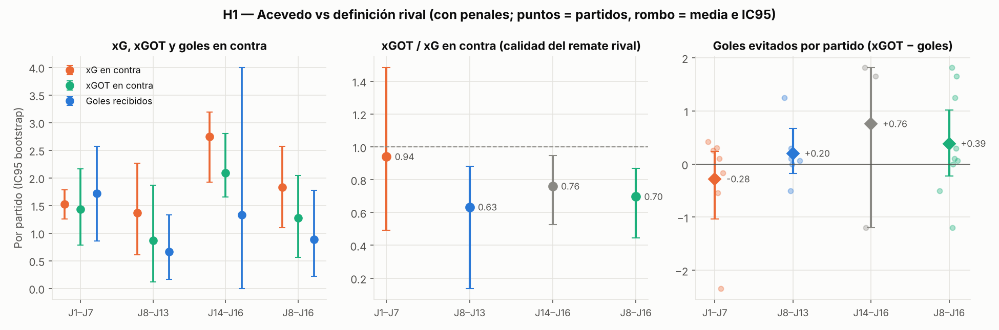
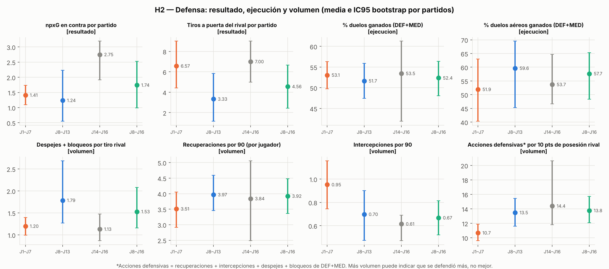
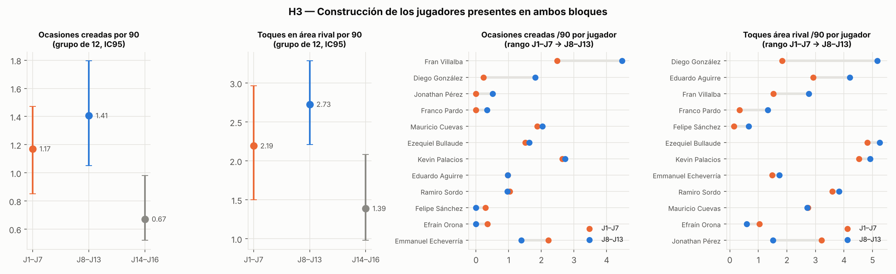
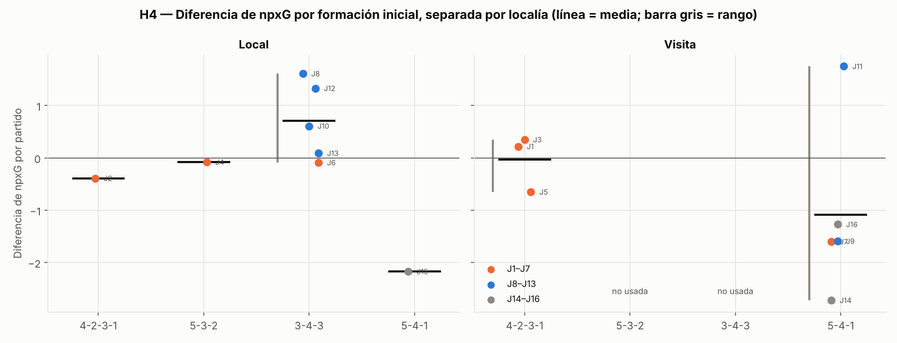
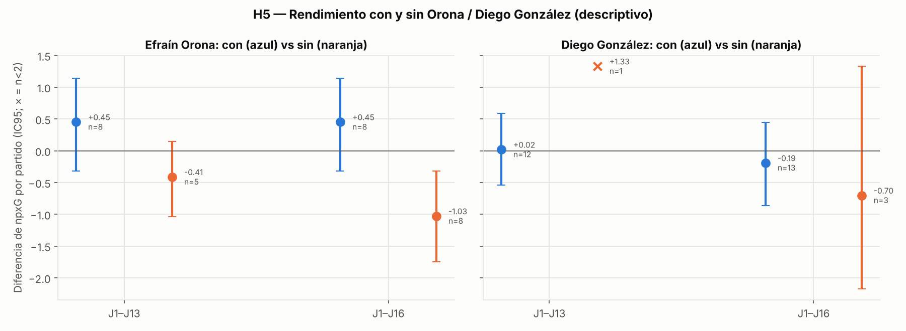
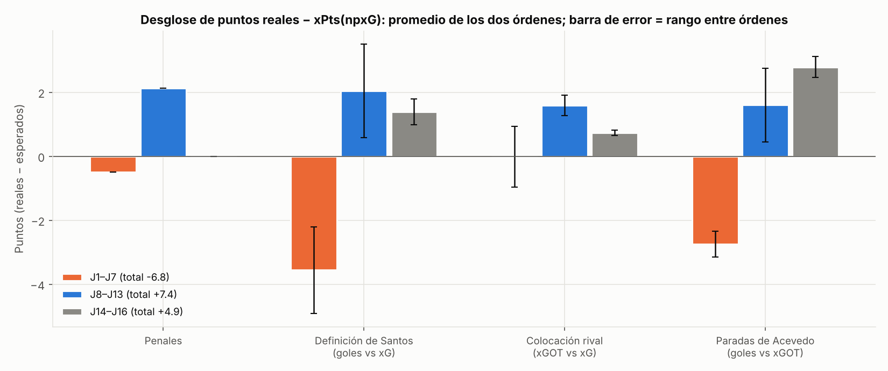

# Santos Laguna, Apertura 2026 — v2: portero, defensa, construcción, roles y disponibilidad

Este informe amplía el informe v1 (`output/informe.md`), que no se modificó.

- **Hipótesis y reglas de decisión:** se escribieron y confirmaron en git **antes** de calcular (`hipotesis_preregistradas.md`, commit `56110cb`).
- **Cálculos:** salen de `src/analisis_v2.py` (semilla 20261120, bootstrap de partidos con 10 000 remuestreos).
- **Tablas:** están en `tablas_v2.xlsx`; los corchetes indican la hoja. La hoja `filas_usadas_ND` registra, para cada prueba, cuántas filas se usaron y cuántas se excluyeron por N/D o por regla.

---

## Resumen ejecutivo

1. **H1, Acevedo — NO CONCLUYENTE, con tendencia a refutada.** En J8–J13 se recibieron 4 goles con 8.22 xG en contra (con penales); la brecha es de 4.2 goles. Alrededor del **72 % de esa brecha se debe a remates rivales poco peligrosos**: la relación xGOT/xG baja de 0.94 a 0.63. Solo un **28 %** corresponde a paradas (+1.2 goles evitados; IC95 por partido −0.18 a +0.67). Sin los partidos con penal, o con cortes en J7 o J9, queda **refutada**.
2. **H2, defensa — NO CONCLUYENTE.** No mejoran con claridad ni el npxG en contra ni el % de duelos ganados (este baja de 53 % a 52 %). Lo que sí sube es el **volumen** de acciones defensivas por tiro rival: es consistente con defender más cerca del área, no necesariamente mejor. El resultado depende de J9: sin ese partido, el npxG en contra sí mejora.
3. **H3, construcción — NO CONCLUYENTE.** En los 12 jugadores que estuvieron en ambos bloques suben las ocasiones creadas (+0.24 por 90) y los toques en el área rival (+0.53 por 90), pero con IC que incluyen el 0. Con el corte en J9, las ocasiones creadas bajan. La mejora se concentra en Villalba y Diego González. **No se pudieron medir** los pases ni las conducciones progresivas.
4. **H4, formación — NO CONCLUYENTE; H5, bajas — consistente para Orona y no concluyente para Diego González.** El nuevo dibujo empezó en J6, dos jornadas antes de la racha. Como local mejora y como visitante empeora, y una misma formación rinde muy distinto según el bloque. Sin Orona, el npxG en contra fue peor también en J1–J13, pero 4 de esas 5 ausencias caen en J1–J5.
5. **Descomposición actualizada:** se mantienen los cuatro bloques de v1 (H1 y H2 no justifican moverlos). Los **7.4 puntos de sobre-rendimiento** se desglosan así:
   - penales: 2.1 (29 %)
   - oportunidad de los goles de Santos: 2.0 (28 %)
   - colocación de los remates rivales: 1.6 (22 %)
   - **paradas de Acevedo: 1.6 (22 %; rango 0.5–2.7)**

   **Alrededor de la mitad del sobre-rendimiento (≈3.6 puntos, el 21 % del salto total) sigue sin explicación** y es compatible con la varianza.

---

## Paso 0 — Validación

Las 25 comprobaciones pasan [0_verificaciones]:

| Comprobación | Resultado |
|---|---|
| Claves (jornada + nombre exacto) en los 4 archivos con jugador | Sin duplicados; todas existen en `jugadores_partido` |
| Cobertura | Defensa = 237 participaciones de campo; construcción = 253; roles = 176 titulares (11 por jornada); formación = base |
| **Minutos** contra `jugadores_partido` | 0 diferencias (16 + 237 + 253 filas) |
| **Goles recibidos** contra `partidos_santos` | 16/16 coinciden; **20 en total** |
| **xg_en_contra** contra `xg_rival` | 16/16 coinciden |
| Tiros a puerta recibidos; goles evitados = xGOT − goles; penales | Todo coincide |
| **J10, Pachuca** | **Coherente:** xGOT 0.00 con 0 tiros a puerta recibidos (la base también registra 0), 0 paradas y 0 goles. Pachuca remató 11 veces (0.79 xG), ninguna a puerta. Un xGOT de 0 es lo esperable sin remates a puerta. |
| Paradas + goles = tiros a puerta | Solo fallan **J6** (2 tiros a puerta, 3 paradas) y **J15** (9 tiros a puerta, 8 paradas, 0 goles), las inconsistencias ya conocidas. **Quedan fuera de la tasa de paradas**; su xGOT y sus goles evitados sí se usan. |

**Vacíos (% N/D) [0_ND_por_campo]:**

| Archivo | Campo | % N/D | Uso |
|---|---|---:|---|
| portero | salidas_exitosas | 100 % | No se usa |
| defensa | duelos_ganados / duelos_totales | 5.9 % / 7.6 % | Se excluyen esas filas de las tasas de duelos (17 filas de 183 en DEF+MED) |
| defensa | entradas_ganadas, perdidas_de_balon | 100 % | No se usan |
| defensa | faltas_recibidas | 51 % | No se usa como evidencia |
| construcción | pases_progresivos, pases_clave, conducciones_progresivas | 100 % | No se usan |
| construcción | grandes_ocasiones_creadas / regates_exitosos / centros_precisos | 92 % / 57 % / 59 % | No se usan como evidencia |
| construcción | xa | **30.8 % (78 de 253)** | Solo filas con dato; sus minutos salen del denominador |
| construcción | pases_largos_precisos | 23.7 % | Igual que xa |
| construcción | ocasiones_creadas, toques_area_rival | 6.3 % (las 16 filas del portero) | Sin pérdida en jugadores de campo |
| roles | posicion_en_formacion | 1 fila (Villalba J4) | Excluida |
| roles | minuto_entrada | 100 % por diseño | No se usa |
| roles | motivo_salida | 97.7 % (4 lesiones) | No se usa para inferir cambios tácticos |
| disponibilidad | jornada_fin | 33 % | Se lee `detalle`; no se convierte en variable binaria |

---

## H1. ¿El sobre-rendimiento defensivo de J8–J13 se debe a paradas de Acevedo?

**[H1_resumen_bloques] Versión a) completa, con penales:**

| Bloque | Goles | xG en contra | xGOT en contra | xGOT/xG (IC95) | Goles evitados (por partido, IC95) | Brecha xG − goles | Parte por definición rival (xG − xGOT) | Parte por paradas (xGOT − goles) |
|---|---:|---:|---:|---|---|---:|---:|---:|
| J1–J7 | 12 | 10.67 | 10.03 | 0.94 (0.49–1.49) | −1.97 (−0.28; −1.03 a +0.23) | −1.33 | +0.64 | −1.97 |
| **J8–J13** | 4 | 8.22 | 5.20 | **0.63 (0.14–0.88)** | **+1.20 (+0.20; −0.18 a +0.67)** | 4.22 | **3.02 (72 %)** | **1.20 (28 %)** |
| J14–J16 | 4 | 8.25 | 6.27 | 0.76 (0.53–0.95) | +2.27 (+0.76; −1.20 a +1.82) | 4.25 | 1.98 | 2.27 (53 %) |
| J8–J16 | 8 | 16.47 | 11.47 | 0.70 (0.45–0.87) | +3.47 (+0.39; −0.23 a +1.02) | 8.47 | 5.00 | 3.47 (41 %) |

**Versión b) sin partidos con penal en contra (excluye J4 y J8):** en J8–J13 quedan 3 goles con 6.64 xG y 3.91 xGOT. La relación xGOT/xG pasa de 0.96 a **0.59**. De la brecha de 3.64, las paradas aportan 0.91 (**25 %**).

**Tasa de paradas [H1_tasa_paradas]** (sin J6 ni J15): J1–J7, 72.7 % (IC 61–82; 6 partidos); J8–J13, 80.0 % (IC 74–92; 6 partidos); J14–J16, 66.7 % (2 partidos). Los intervalos se solapan.

**Sensibilidad [H1_sensibilidad]:** de 18 variantes (2 versiones × 3 cortes + 6 exclusiones de un partido), **10 dan "refutada" y 8 "no concluyente"; ninguna da "apoyada"**.
- Con los cortes en J7 y en J9, o en la versión b, el resultado es **refutada**.
- **Sin J9 (Toluca)**, los goles evitados de J8–J13 bajan a −0.05: la contribución de Acevedo en el bloque se concentra en ese partido (+1.25).
- Sin J11, los goles evitados tienen un IC que excluye el 0 (+0.34 por partido), pero las paradas siguen siendo solo el 38 % de la brecha.

**Veredicto: NO CONCLUYENTE (versión principal), con tendencia a REFUTADA.** La mayor parte de los "goles que no entraron" en J8–J13 se debe a que los rivales remataron a puerta con poca calidad. Acevedo aportó algo (+1.2 goles), pero con un IC que incluye el 0. El mismo portero tuvo −2.0 goles evitados en J1–J7 y +2.3 en J14–J16. Ese vaivén es consistente con **varianza** más que con un cambio de nivel del portero.

---

## H2. ¿La defensa mejoró de verdad en J8–J13?

**[H2_bloques]** Defensas y mediocampistas: 183 filas. Para las tasas de duelos se excluyen 3 filas N/D en J1–J7 y 12 en J8–J13 (detalle en `filas_usadas_ND`).

| Tipo | Métrica | J1–J7 | J8–J13 | Diferencia (IC95) |
|---|---|---:|---:|---|
| Resultado | npxG en contra por partido | 1.41 | 1.24 | −0.17 (−0.97 a +0.81) |
| Resultado | Tiros a puerta del rival por partido | 6.57 | 3.33 | −3.24 (−6.55 a +0.14) |
| Contexto | Tiros del rival por partido | 16.6 | 14.0 | −2.6 (−8.2 a +3.0) |
| Contexto | Posesión de Santos | 49.4 % | 55.0 % | +5.6 (−2.6 a +13.9) |
| Ejecución | % de duelos ganados | 53.1 | 51.7 | −1.4 (−6.5 a +3.9) |
| Ejecución | % de duelos aéreos ganados | 51.9 | 59.6 | +7.7 (−10.6 a +22.7) |
| Volumen | Recuperaciones por 90 | 3.51 | 3.97 | +0.46 (−0.32 a +1.32) |
| Volumen | Intercepciones por 90 | 0.95 | 0.70 | −0.25 (−0.55 a +0.04) |
| Volumen | Despejes por 90 | 2.28 | 2.86 | +0.58 (−0.21 a +1.34) |
| Volumen | **Despejes + bloqueos por tiro rival** | 1.20 | **1.79** | **+0.59 (+0.03 a +1.55)** |
| Volumen | **Acciones defensivas por cada 10 puntos de posesión rival** | 10.7 | **13.5** | **+2.8 (+0.6 a +5.1)** |

**Mismos jugadores frente a cambio de nombres [H2_shift_share]** (9 jugadores con ≥ 90 minutos en ambos bloques):

| Métrica | Cambio | Mismos jugadores | Cambio de nombres / mezcla de minutos |
|---|---:|---:|---:|
| % de duelos ganados | −1.4 | **−5.9** | +4.5 (Cáseres, 57.5 %, entra; Bullaude pasa menos tiempo en el medio) |
| % de duelos aéreos ganados | +7.7 | +5.3 | +2.4 |
| Despejes por 90 | +0.58 | +0.26 | +0.31 |
| Intercepciones por 90 | −0.25 | −0.19 | −0.06 |

**Sensibilidad [H2_sensibilidad]:** con el corte en J7, el npxG en contra **no mejora** (+0.02); con el corte en J9, la diferencia es nula (−0.01). **Sin J9**, en cambio, el npxG en contra (−0.62) y los tiros a puerta del rival (−4.4) mejoran con IC que excluyen el 0. El resultado depende de un solo partido: Toluca, 3.45 npxG en contra.

**Veredicto: NO CONCLUYENTE.** Ningún indicador de resultado ni de ejecución mejora con un IC que excluya el 0 en el corte principal. Lo único claro es que **subió el volumen**: más despejes y bloqueos por cada tiro rival, y más acciones defensivas por cada minuto de posesión rival. Es consistente con un bloque más bajo y que defendió más cerca del área, no con una defensa mejor en duelos. Los mismos jugadores ganaron *menos* duelos; el mantenimiento del % se explica por la entrada de Cáseres.

---

## H3. ¿La mejora de los mismos jugadores viene de mejor construcción?

**Grupo:** 12 jugadores de campo con ≥ 90 minutos en J1–J7 y en J8–J13: D. González, Aguirre, Orona, Echeverría, Bullaude, Sánchez, Villalba, Pardo, J. Pérez, Palacios, Cuevas y Sordo. Filas usadas: 71 en J1–J7 y 63 en J8–J13. **xA: 78 de 253 filas (30.8 %) son N/D en el archivo.** En este grupo se excluyen 11 filas en J1–J7 y 17 en J8–J13; pases largos precisos, 10 y 15.

**[H3_bloques_grupo]**

| Tipo | Métrica | J1–J7 | J8–J13 | J14–J16 | Diferencia J8–J13 (IC95) |
|---|---|---:|---:|---:|---|
| Principal | Ocasiones creadas por 90 | 1.17 | 1.41 | 0.67 | +0.24 (−0.24 a +0.74) |
| Principal | Toques en el área rival por 90 | 2.19 | 2.73 | 1.39 | +0.53 (−0.40 a +1.43) |
| Secundaria | % de pases completados | 83.8 | 86.9 | 87.5 | +3.1 (−0.6 a +6.7) |
| Secundaria | Pases largos precisos por 90 | 2.84 | 2.60 | 2.62 | −0.24 (−1.06 a +0.63) |
| Secundaria | xA por 90 (solo filas con dato) | 0.124 | 0.165 | 0.115 | +0.04 (−0.01 a +0.10) |

**Por jugador [H3_por_jugador]:** la subida se concentra en dos jugadores.
- **Fran Villalba:** ocasiones creadas por 90, de 2.5 a 4.5.
- **Diego González:** ocasiones, de 0.2 a 1.8; toques en el área, de 1.8 a 5.2. Coincide con su paso de extremo a medio o carrilero izquierdo (H4).
- **Bullaude:** sube en xA por 90 (de 0.07 a 0.26), pero no en ocasiones creadas.
- El resto cambia poco o baja (Echeverría, Orona).

**Sensibilidad:** con el corte en J9, las ocasiones creadas **bajan** (−0.10). Los toques en el área suben en las 9 variantes, sin que ninguna excluya el 0.

**No medible:** los **pases progresivos** y las **conducciones progresivas** son 100 % N/D. Tampoco hay pases clave. La "construcción" solo se puede aproximar con ocasiones creadas, toques en el área y precisión de pase.

**Veredicto: NO CONCLUYENTE.** Las dos métricas principales suben en la estimación puntual, pero sin un IC que excluya el 0, y una cambia de signo con el corte en J9. En J14–J16 las dos caen por debajo de J1–J7. Los datos son consistentes con que parte de la mejora de los mismos jugadores fuera de construcción (Villalba y D. González), pero no lo demuestran.

---

## H4. ¿El cambio de formación y de roles coincide con el cambio de rendimiento? (descriptivo)

**Formación × localía [H4_formacion_x_localia]** (diferencia de npxG por partido):

| Formación | Local | Visita |
|---|---|---|
| 4-2-3-1 | −0.39 (J2; n=1) | −0.03 (J1, J3, J5; rango −0.65 a +0.35) |
| 5-3-2 | −0.08 (J4; n=1) | no usada |
| 3-4-3 | **+0.71** (J6, J8, J10, J12, J13; rango −0.09 a +1.61) | **no usada** |
| 5-4-1 | −2.17 (J15; n=1) | −1.09 (J7, J9, J11, J14, J16; rango −2.72 a +1.75) |

**Misma formación, distinto bloque [H4_formacion_localia_bloque]:**
- 3-4-3 como local: −0.09 en J6 y +0.91 en J8–J13.
- 5-4-1 como visitante: −1.60 en J7, +0.08 en J9 y J11, −2.00 en J14 y J16.

El rendimiento cambia mucho **dentro** de cada formación, así que el dibujo por sí solo no explica la racha.

**Roles clave [H4_roles_clave_por_bloque]:**
- **Cáseres:** interior fijo (9 de 9 titularidades).
- **Villalba:** pasa de mediapunta o extremo a **interior fijo** (5/5 en J8–J13).
- **D. González:** de extremo derecho a **medio o carrilero izquierdo**.
- **Cuevas:** de lateral a **medio o carrilero derecho**.
- **Aguirre:** de delantero a **extremo**.
- **Bullaude:** de mediapunta a **extremo o medio izquierdo**.
- **Delantero centro:** Tahiel Jiménez y Lozano.
- **Centrales:** Sánchez y Pardo, fijos; "central" no indica el lado.

**Regla pre-registrada:**
- Timing: **el cambio no cae en la ventana** (el primer 3-4-3/5-4-1 es J6; el último 4-2-3-1, J5).
- Dentro de la misma localía, las formaciones nuevas son **mejores como local (+0.47)** y **peores como visitante (−1.06)**.
- El pre-registro no especificaba el caso mixto. En el código lo traté como **no concluyente**. Con la lectura estricta ("la diferencia va al revés en alguna localía") sería **refutada**. Lo señalo para que puedas elegir la lectura.

**Veredicto: NO CONCLUYENTE (descriptivo, no causal).** El 3-4-3 se usó **solo como local** y el 5-4-1 casi solo como visitante: la formación no se puede separar de la localía. Lo que sí coincide con el quiebre es la **estabilización de roles** del mediocampo: Cáseres y Villalba como interiores, D. González y Cuevas por banda. Es una descripción, no una causa.

---

## H5. ¿La caída de J14–J16 se asocia a las bajas de Orona y Diego González?

La presencia sale de la tabla del README, cruzada sin discrepancias con los minutos de la base [H5_presencia]:
- **Orona:** sin participación en J1, 2, 3, 5, 9, 14, 15 y 16. En J13, parcial (sale lesionado al 21).
- **D. González:** sin participación en J12, 15 y 16. En J14 jugó completo y se lesionó.

Las filas de `disponibilidad_jugadores.csv` se leyeron por `detalle` y no se convirtieron en una variable binaria [H5_disponibilidad_csv].

**[H5_con_sin]**

| Jugador | Alcance | Con él: dif npxG (n) | Sin él: dif npxG (n) | Sin − con (IC95) | npxG en contra, sin − con (IC95) |
|---|---|---|---|---|---|
| Orona | J1–J13 | +0.45 (8) | −0.41 (5: J1, 2, 3, 5, 9) | −0.86 (−1.82 a +0.11) | **+0.88 (+0.12 a +1.79)** |
| Orona | J1–J13 sin J13 | +0.50 (7) | −0.41 (5) | −0.92 (−1.93 a +0.12) | +0.76 (+0.02 a +1.64) |
| Orona | J1–J16 | +0.45 (8) | −1.03 (8) | −1.48 (−2.80 a −0.08) | +1.21 (+0.52 a +1.90) |
| D. González | J1–J13 | +0.02 (12) | +1.33 (1: J12) | n < 2 | n < 2 |
| D. González | J1–J16 | −0.19 (13) | −0.70 (3) | −0.51 (−2.13 a +1.36) | +0.74 (−0.13 a +1.70) |

**Veredicto:**
- **Orona: CONSISTENTE** (el máximo posible por diseño). También en J1–J13, sin él se concedió más npxG.
  - **Confusión importante:** 4 de sus 5 ausencias en J1–J13 son J1–J5, el periodo del 4-2-3-1, antes de Cáseres y Lozano. Su efecto no se puede separar del de esos cambios.
- **Diego González: NO CONCLUYENTE.** En J1–J13 solo faltó en J12, uno de los mejores partidos (5–0).
- **Ambos:** en J15–J16 faltaron a la vez, así que esos partidos no permiten separarlos. Con 3 partidos en J14–J16, la hipótesis no puede pasar de "consistente / no concluyente".

---

## Actualización de la descomposición del salto

**¿Cambia la estructura de v1?** No.
- H1 no atribuye a Acevedo el sobre-rendimiento defensivo.
- H2 no muestra una mejora defensiva real.

Por eso **rebote (+5.8), calendario (+1.4), mejora de npxG (+2.6) y sobre-rendimiento (+7.4) se mantienen**. Lo nuevo es el desglose del sobre-rendimiento, gracias al xGOT.

**[D_sobre_rendimiento]** Puntos reales − xPts(npxG), desglosados en cadena con Poisson analítico. Se muestran dos órdenes: primero ataque y primero defensa.

| Componente | J1–J7 | **J8–J13** (rango entre órdenes) | % del sobre-rendimiento J8–J13 | J14–J16 |
|---|---:|---|---:|---:|
| Penales (xPts con xG − con npxG) | −0.5 | **+2.1** | 29 % | 0.0 |
| Oportunidad de los goles de Santos (goles reales vs xG) | −3.6 | **+2.0** (0.6 a 3.5) | 28 % | +1.4 |
| Colocación de los remates rivales (xGOT vs xG) | 0.0 | **+1.6** (1.3 a 1.9) | 22 % | +0.7 |
| **Paradas de Acevedo** (goles vs xGOT) | **−2.7** | **+1.6** (0.5 a 2.7) | **22 %** (6 % a 37 %) | **+2.8** |
| **Total** | −6.8 | **+7.4** | 100 % | +4.9 |

**Respuesta:**
- **A Acevedo se le pueden atribuir unos 1.6 de los 7.4 puntos** (rango 0.5–2.7 según el orden): un 22 % del sobre-rendimiento, o un 9 % del salto total de 17.1 puntos.
- No es la explicación principal. Además, el mismo portero restó 2.7 puntos en J1–J7, así que ni siquiera esa parte es claramente "habilidad sostenida".
- **Sin explicar quedan ≈3.6 puntos** (oportunidad de los goles de Santos + colocación rival): **≈49 % del sobre-rendimiento, o ≈21 % del salto total**. Es compatible con varianza, pero estos datos no permiten afirmarlo.
- Los penales (≈12 % del salto) son un evento identificado, no una explicación de nivel.

**Salto total de 17.1 puntos, reformulado:**

| Componente | Puntos | % del salto |
|---|---:|---:|
| Rebote de J1–J7 | 5.8 | 34 % |
| Calendario | 1.4 | 8 % |
| Mejora de npxG | 2.6 | 15 % |
| Penales | 2.1 | 12 % |
| Paradas de Acevedo | 1.6 | 9 % |
| **Varianza sin explicar** (oportunidad de goles + colocación rival) | 3.6 | 21 % |

### Dónde los datos nuevos contradicen o matizan el informe v1

1. **v1 decía que el sobre-rendimiento de J8–J13 "sale sobre todo de recibir 3 goles sin penal con 7.4 npxG en contra". En puntos, esto se contradice en parte:**
   - El componente defensivo (colocación rival + paradas) explica 3.2 de 7.4 puntos (43 %).
   - Penales (29 %) y oportunidad de los goles de Santos (28 %) suman más.
   - En goles, v1 tenía razón: la brecha defensiva es la mayor.
2. **v1 decía que el ataque "definió en línea con su npxG".** Es cierto en goles: 11 goles sin penal con 11.2 npxG. Pero esos goles llegaron cuando decidían partidos (1–0, 2–1, 2–1, 3–2), lo que vale +2.0 puntos. v1 lo trataba como neutro.
3. **El proxy "xG − goles" de Acevedo (+4.2 en J8–J13) de v1** mezclaba paradas con mala definición rival. Con el xGOT, la parte de paradas baja a +1.2.
4. **Regla de N/D:** en v1, el npxG por 90 de cada jugador (sección 6) usaba todos sus minutos como denominador sin sumar los xG N/D. Con la regla actual, eso equivale a tratar los N/D como cero. La suma por jugador reproducía el total del equipo (error ≤ 0.12 por partido), pero ese reparto de v1 debe leerse como aproximado.
5. **Lo que v1 ya decía y se confirma:** el 3-4-3 está confundido con la localía, y J14–J16 incluyen una actuación alta del portero (+2.3 goles evitados).

---

## Conclusión actualizada: mejora real vs suerte, rival y eventos

- **La parte "real" no crece con los datos nuevos.**
  - La mejora ofensiva de v1 (+0.78 npxG por partido) tiene un correlato descriptivo en la construcción de Villalba y D. González y en la estabilización de roles del mediocampo. Ninguna de las dos señales es concluyente.
  - La defensa no mejoró de forma demostrable: defendió **más**, no **mejor**.
- **La parte de suerte y eventos se precisa:**
  - De los 7.4 puntos de sobre-rendimiento, 2.1 son penales y 1.6 son paradas de Acevedo. Esto último es poco robusto y el mismo portero rindió en sentido contrario en J1–J7.
  - ≈3.6 puntos son oportunidad de los goles y remates rivales flojos, que estos datos no explican.
- **En una frase:** la racha J8–J13 es consistente con un Santos algo mejor en ataque, que se encontró rivales más accesibles, 6 penales y 3 expulsiones a favor, rivales que remataron mal a puerta y un portero algo por encima de lo esperado. La mejora real sigue explicando aproximadamente **una quinta parte del salto (15–22 %)**.

**Sólido:** el rebote de J1–J7; el sobre-rendimiento de J8–J13; que la brecha defensiva en goles es sobre todo de calidad del remate rival (xGOT/xG = 0.63); el aumento del volumen defensivo por tiro rival.

**Hipótesis (no demostradas):** la construcción mejorada de Villalba y D. González; el efecto de la estabilización de roles; el efecto de la ausencia de Orona; la contribución de Acevedo.

---

## Limitaciones

- **Muestras muy pequeñas** (3–9 partidos por bloque). Varios resultados cambian **por un solo partido (J9, Toluca)** o por el corte (J7/J9). Está indicado en cada hipótesis.
- **xGOT:**
  - Incluye penales y no hay una versión sin penales; por eso la versión b excluye J4 y J8.
  - J10 tiene 0.00 publicado (coherente con 0 tiros a puerta).
  - Las tasas de paradas excluyen J6 y J15 por inconsistencias de la fuente.
- **Defensa:**
  - Los conteos (despejes, bloqueos) miden volumen, no calidad.
  - No hay entradas ganadas ni pérdidas de balón.
  - "Defensa" y "Mediocampista" son posiciones amplias de FotMob, no roles.
- **Construcción:** no hay pases ni conducciones progresivas. xA tiene un 31 % de N/D, así que las tasas de xA usan solo las filas con dato y pueden sesgarse hacia los jugadores con más participación ofensiva registrada.
- **Roles:** solo los titulares y el dibujo inicial. No se ven los cambios dentro del partido ni el lado de los centrales.
- **Disponibilidad:**
  - No es una matriz médica completa.
  - Las ausencias de Orona están confundidas con la fase J1–J5.
  - J15–J16 tienen las dos bajas a la vez.
- **Pre-registro:** al escribirlo ya conocía los resultados de v1 y había leído las filas crudas del portero durante la validación. La regla de H4 no cubría el caso mixto (ver H4).
- **Descomposición:** el desglose depende del orden (se dan los dos y su rango) y del supuesto Poisson (independencia, sin estado del marcador ni localía).

---

## Qué sigue sin poder responderse con estos datos

1. **Presión y altura del bloque:** el PPDA y las entradas ganadas son N/D. No se puede comprobar si Santos presionó más o defendió más bajo; el volumen de despejes solo lo sugiere.
2. **Progresión del balón:** los pases y conducciones progresivas y los pases clave son 100 % N/D. No se sabe si los mismos jugadores hicieron avanzar mejor el balón.
3. **Por qué los mismos jugadores produjeron más** (≈46 % de la mejora ofensiva en v1): ¿instrucciones tácticas, roles nuevos, confianza, rivales? Sin datos de tracking ni de eventos por zona, solo hay correlatos descriptivos (los roles de H4).
4. **Si las paradas de Acevedo son habilidad o varianza:** harían falta más partidos o el xGOT de temporadas anteriores para estimar su nivel de base.
5. **El efecto de las expulsiones rivales sobre el xG:** sin xG por minuto, no se puede aislar lo generado contra 10 jugadores (J9, J12, J13, J16).
6. **El efecto de la formación al margen de la localía:** el 3-4-3 nunca se usó como visitante.
7. **El motivo de varias ausencias** (Aldo López J8–J9, Palacios J12, Pardo J7): no consta en las fuentes.
8. **Calidad de las ocasiones propias tras el remate:** no hay xGOT a favor de Santos, así que la "oportunidad de los goles" no se puede separar en calidad de remate y azar.
